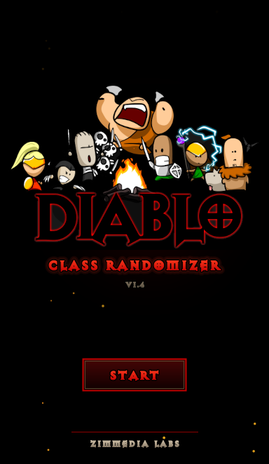
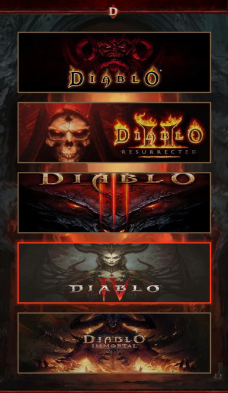
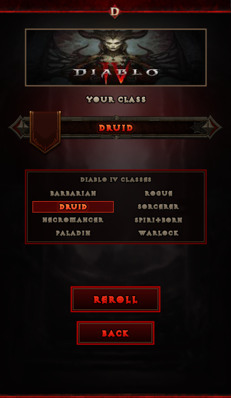

Created a simple Diablo Class Randomizer after playing the D4 Beta and not having a clue on what class I would play at release. Pick your game and it picks your class.

Works for Diablo | Diablo II: Resurrected | Diablo 3 | Diablo 4 | Diablo Immortal - Can be used as Web App here: https://zimmedialabs.github.io/Diablo-Class-Randomizer/

- UPDATED for Diablo IV: Lord of Hatred (Paladin and Warlock)
- Warlock added to Diablo II: Resurrected
- Druid, Tempest and Warlock added to Diablo Immortal
- Hidden Hellfire classes (Bard and Barbarian) added to Diablo
- Reroll as many times as you want, it won't give you the same class twice in a row
- Click anywhere while it's rolling to skip straight to the result
- Space/Enter to reroll, Esc to go back

   

It's just one .exe, no install needed.

All Diablo art and sounds belong to Blizzard. Fan project, not affiliated with Blizzard.

---------------------------------------------------------------------------------------------------------------------------------------------

## 🛡️ Is this safe?

> [!IMPORTANT]
> **Totally fair question for any random .exe on the internet. Here's exactly what it does and doesn't do:**
>
> - ✅ **No internet connection**
> - ✅ **No admin rights, no installer, nothing added to the registry**
> - ✅ **Only writes one thing:** a copy of its fonts to your Temp folder so Windows can load them
> - ✅ **100% open source:** every line of code is right here in the repo
> - ✅ **Build it yourself if you'd rather:** the steps are below, and the result is the same app.

> [!NOTE]
> **Windows may show a SmartScreen warning** because the app isn't signed with a paid certificate. Click **More info → Run anyway**, or build it yourself:
> ```powershell
> git clone https://github.com/ZiMMediaLabs/Diablo-Class-Randomizer
> cd Diablo-Class-Randomizer
> dotnet build "Diablo Class Randomizer.csproj" -c Release
> ```

